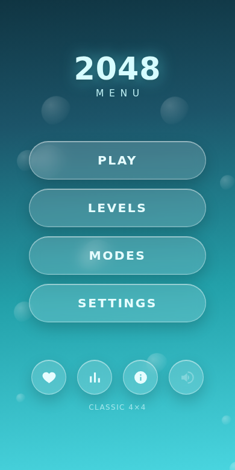
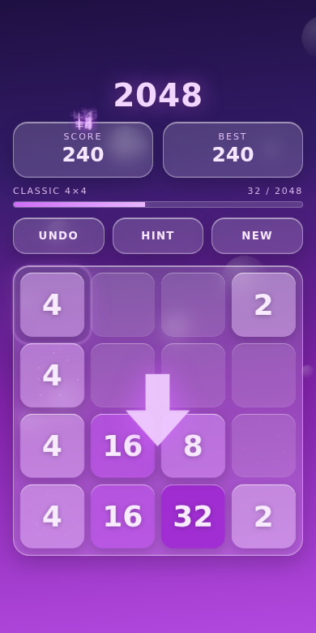
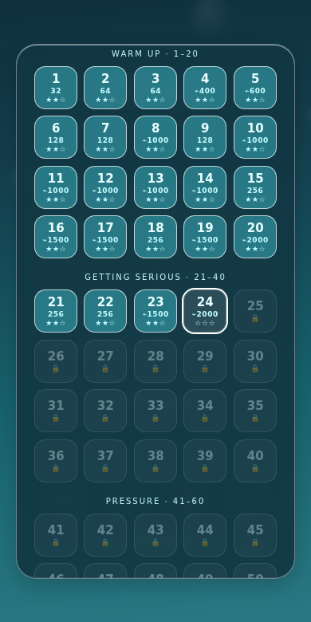
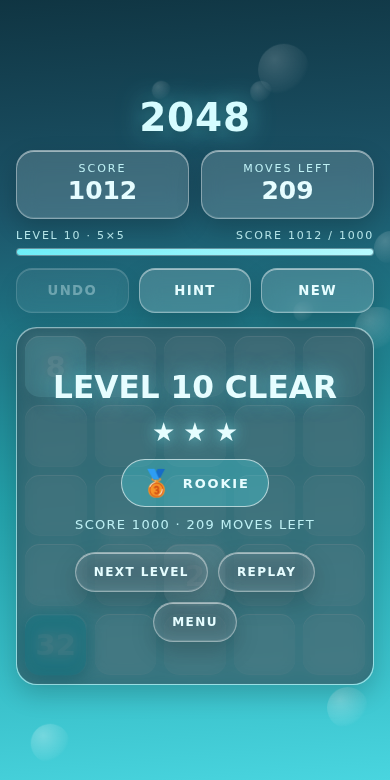
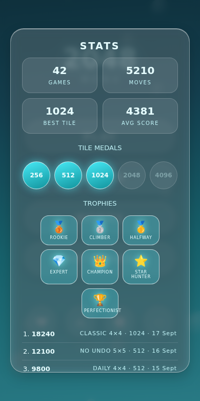
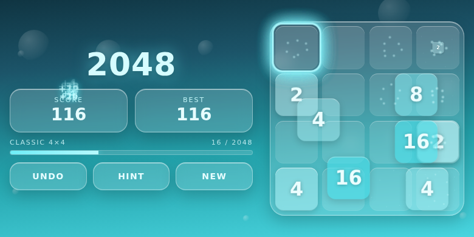

# 2048 — بازی پازل موبایلی

[](https://github.com/AAli-gh/2042-game/actions/workflows/ci.yml)
[](https://github.com/AAli-gh/2042-game/actions/workflows/release.yml)
[](LICENSE)

نسخهٔ موبایلیِ بازی کلاسیک ۲۰۴۸ با ظاهر شیشه‌ای (glassmorphism) روی گرادیان فیروزه‌ای،
نوشته‌شده با HTML/CSS/JS خالص و بدون هیچ وابستگی.

| منو | بازی (تم نئون) | مراحل |
|---|---|---|
|  |  |  |

| پایان مرحله | آمار و نشان‌ها | حالت افقی |
|---|---|---|
|  |  |  |

**[دانلود APK](dist/2048.apk)** · نسخهٔ وب: بعد از فعال‌کردن GitHub Pages روی
`https://aali-gh.github.io/2042-game/`

## امکانات

- **صفحهٔ منو** با PLAY / MODES / SETTINGS و میان‌برهای علاقه‌مندی، آمار، راهنما و صدا
- **۱۰۰ مرحله در پنج فصل**: هر مرحله یک هدف (رسیدن به یک خانه یا امتیاز) و یک بودجه
  (تعداد حرکت یا زمان) دارد؛ تمام‌کردنش یک ستاره می‌دهد و نگه‌داشتن نیمی از بودجه سه ستاره.
  مرحلهٔ ۱۰۰ همان چیزی است که اسم بازی از آن آمده: رسیدن به ۲۰۴۸ روی تختهٔ ۴×۴
- **نشان‌ها (Trophies)**: ۱۰ مرحله 🥉، ۲۵ مرحله 🥈، **۵۰ مرحله 🥇**، ۷۵ مرحله 💎،
  **همهٔ ۱۰۰ مرحله 👑**، و دو نشان ستاره‌ای: ۱۵۰ ستاره ⭐ و سه‌ستاره‌کردن همهٔ مراحل 🏆
- **چهار حالت بازی**: کلاسیک، زمان‌دار (۳ دقیقه)، بدون Undo، و **چالش روزانه**
  (چیدمان روزانهٔ یکسان برای همه، با یک مولد تصادفیِ seed‌دار)
- **چهار اندازهٔ تخته**: ۳×۳، ۴×۴، ۵×۵، ۶×۶
- **چهار تم رنگی**: فیروزه‌ای، نئون، غروب و شب — همهٔ رنگ‌ها از دو متغیر رنگ‌مایه ساخته می‌شوند
- **دکمهٔ HINT**: بهترین حرکت را با expectimax (عمق ۳ روی ۴×۴) پیشنهاد می‌دهد
- **Undo تا ۲۰ حرکت** (دکمهٔ UNDO یا کلید `Z`)
- **جلوه‌ها**: ذرات و درخشش هنگام ادغام، امتیاز شناور `+۱۶`، لرزش تخته برای حرکت غیرمجاز،
  حباب‌های شناور پس‌زمینه، و نوار پیشرفت تا ۲۰۴۸
- **آمار و دستاورد**: تعداد بازی‌ها، حرکات، بهترین خانه، میانگین امتیاز، مدال‌های
  ۲۵۶ تا ۴۰۹۶ و جدول ۵ رکورد برتر
- **آموزش اولین اجرا**: یک انگشت انیمیشنی حرکت را نشان می‌دهد؛ از Settings دوباره قابل نمایش است
- **چیدمان افقی و تبلت**: در حالت افقی تخته کنار پنل قرار می‌گیرد و اندازهٔ خانه‌ها و فاصله‌ها
  از عرض واقعی تخته محاسبه می‌شود
- **دسترس‌پذیری**: برچسب‌های screen reader و ناحیهٔ زندهٔ اعلام امتیاز، حالت **کنتراست بالا**
  (در اولین اجرا از `prefers-contrast` سیستم پیروی می‌کند) و حلقهٔ فوکوس واضح
- **کنترل لمسی**: کشیدن انگشت در چهار جهت (و کلیدهای جهت‌دار / WASD / `Z` / `H` روی دسکتاپ)
- **صدا و موسیقی**: افکت‌های کوتاه با Web Audio، و یک **موسیقی پس‌زمینهٔ ملایمِ تولیدشده** —
  ملودی جعبه‌موسیقی روی گام پنتاتونیک رِ با پدِ آرام و اکوی نرم، بدون هیچ فایل صوتی و بدون مسئلهٔ حق نشر
- **لرزش پلکانی** که با بزرگیِ خانهٔ ادغام‌شده قوی‌تر می‌شود
- **ذخیرهٔ جداگانه برای هر حالت و اندازه**: بازی ۴×۴ کلاسیک با شروع چالش روزانه از بین نمی‌رود؛
  منو با «CONTINUE» و پنجرهٔ MODES با «RESUME» نشان می‌دهند کدام بازی نیمه‌تمام است
  (ذخیرهٔ تک‌خانه‌ایِ نسخه‌های قبل در اولین اجرا خودکار منتقل می‌شود)
- **ذخیرهٔ خودکار**: وضعیت بازی‌ها، رکوردها، آمار و تنظیمات در `localStorage`
- **قابل نصب (PWA)**: manifest + service worker، پس از اولین اجرا آفلاین کار می‌کند

## اجرا در مرورگر

چون service worker و manifest نیاز به پروتکل HTTP دارند، فایل را با یک سرور محلی باز کنید:

```bash
python3 -m http.server 8000
# سپس روی گوشی: http://<آی‌پی-کامپیوتر>:8000
```

باز کردن مستقیم `index.html` هم کار می‌کند، فقط قابلیت نصب/آفلاین غیرفعال می‌شود.

### به‌روزرسانی نسخهٔ وب

سرویس‌ورکر صفحه را **network-first** می‌گیرد، پس هر انتشار تازه در بازدید بعدی به بازیکن می‌رسد و
فقط وقتی آفلاین است نسخهٔ کش‌شده سرو می‌شود. نام کش هم شمارهٔ نسخه را دارد تا کش قبلی پاک شود.

یک نکتهٔ میزبانی: مرورگر خودِ فایل `sw.js` را در کش HTTP نگه می‌دارد و حداکثر تا ۲۴ ساعت بعد
دوباره اعتبارسنجی می‌کند. برای اینکه به‌روزرسانی فوری باشد، میزبان باید این فایل را با
`Cache-Control: no-cache` بدهد — فایل `_headers` همین کار را برای Netlify و Cloudflare Pages
انجام می‌دهد. روی GitHub Pages که هدر سفارشی ندارد، به‌روزرسانی حداکثر با یک روز تأخیر می‌رسد.

## نسخهٔ اندروید (APK)

فایل آمادهٔ نصب: **[`dist/2048.apk`](dist/2048.apk)** (حدود ۵۲ کیلوبایت)

### نصب روی گوشی

۱. فایل `dist/2048.apk` را روی گوشی کپی یا دانلود کن.
۲. بازش کن؛ اگر اندروید اجازه خواست، «نصب برنامه‌های ناشناس» را برای مرورگر یا فایل‌منیجرت روشن کن
   (چون APK با کلید توسعه امضا شده، نه از طریق Google Play).
۳. یا با کابل: `adb install -r dist/2048.apk`

- بستهٔ برنامه: `com.game2048` · حداقل اندروید ۵.۰ (API 21) · هدف API 34
- امضا شده با طرح‌های v1 + v2 + v3
- کاملاً آفلاین؛ هیچ مجوزی (اینترنت، فایل، …) نمی‌خواهد
- **آیکون وفق‌پذیر** (اندروید ۸+) و **صفحهٔ اسپلش** هم‌رنگ گرادیان بازی
- **میان‌بر آیکون**: نگه‌داشتن آیکون → «New game» و «Daily challenge»
- **اشتراک‌گذاری نتیجه** با Share اندروید از روی صفحهٔ پایان بازی
- دکمهٔ Back: اول پنجرهٔ باز، بعد برگشت به منو، و در نهایت خروج از برنامه

### ساختار

| فایل | نقش |
|---|---|
| `index.html` | کل بازی: منو، رابط، استایل و منطق |
| `manifest.json` | متادیتای نصب PWA |
| `sw.js` | کش آفلاین (صفحه network-first، بقیه stale-while-revalidate) |
| `_headers` | هدرهای کش برای Netlify / Cloudflare Pages |
| `icon.svg` | آیکون برنامه (مبنای ساخت آیکون‌های لانچر) |
| `icon-foreground.svg` | لایهٔ جلویی آیکون وفق‌پذیر اندروید |
| `android/` | پوستهٔ اندروید و اسکریپت ساخت APK |
| `dist/2048.apk` | خروجی نصب‌شدنی اندروید |

اپ اندروید یک پوستهٔ نازک `WebView` است (`android/src/com/game2048/MainActivity.java`) که همان
`index.html` را از `assets/` بارگذاری می‌کند — پس منطق بازی فقط در یک جا نگه‌داری می‌شود.
زوم و انتخاب متن خاموش است و `localStorage` روشن.

صفحه از طریق پل `window.Native` با پوسته حرف می‌زند:

| فراخوانی | کار |
|---|---|
| `Native.setBars(top, bottom)` | رنگ نوار وضعیت و نوار ناوبری را با تم انتخاب‌شده هماهنگ می‌کند |
| `Native.share(text)` | پنجرهٔ اشتراک‌گذاری اندروید را باز می‌کند |

اگر راه‌اندازی به هر دلیلی شکست بخورد، به‌جای بسته‌شدن ناگهانی، متن خطا روی صفحه نشان داده می‌شود.

> **نکتهٔ بیلد:** در `res/drawable/splash.xml` تصویر مرکزی باید یک PNG واقعی باشد
> (`@mipmap/ic_launcher_fg`). از اندروید ۸ به بعد `@mipmap/ic_launcher` به XML آیکون وفق‌پذیر
> اشاره می‌کند و قرار دادن آن داخل `<bitmap>` باعث کرش هنگام اجرا می‌شود.

پل فقط روی همان صفحهٔ داخلی در دسترس است؛ `WebViewClient` هر آدرسی جز
`file:///android_asset/` را بلاک می‌کند. میان‌برهای آیکون با reflection روی `ShortcutManager`
ساخته می‌شوند، چون این کلاس مربوط به API 25 است و در `android.jar` نسخهٔ ۲۳ وجود ندارد.

### ساخت دوبارهٔ APK

بدون Gradle و بدون Android Studio؛ فقط بسته‌های استاندارد اوبونتو:

```bash
sudo apt-get install aapt apksigner dalvik-exchange zipalign android-sdk-platform-23 default-jdk
./android/build.sh            # خروجی: dist/2048.apk
```

اسکریپت اگر `android/debug.keystore` نباشد خودش یکی می‌سازد. این کلید در مخزن نیست، پس اگر
روی ماشین دیگری بیلد بگیری کلید امضا عوض می‌شود و برای به‌روزرسانی باید اول نسخهٔ قبلی را
حذف کنی. برای انتشار واقعی، کلید خودت را با `KEYSTORE`، `KS_PASS` و `KS_ALIAS` بده.

آیکون‌های لانچر از `icon.svg` رندر شده‌اند؛ برای ساختن دوباره‌شان کافی است SVG را تغییر بدهی و
با هر ابزار SVG→PNG در پنج اندازهٔ ۴۸/۷۲/۹۶/۱۴۴/۱۹۲ داخل `android/res/mipmap-*/ic_launcher.png` بگذاری.

## مراحل چطور تنظیم شده‌اند

کل جدول ۱۰۰ مرحله از روی اندازه‌گیری ساخته شده، نه حدس: همان حل‌کنندهٔ expectimax که پشت دکمهٔ
HINT است، **۶۲ ترکیبِ هدف و اندازهٔ تخته** را بارها بازی کرد و میانهٔ حرکت‌هایش ثبت شد. بعد:

- بودجهٔ حرکتی = **۲٫۵ برابر میانه** (مرحله‌های زمان‌دار ۱٫۶ برابر؛ مرحله‌های «تنگ» ۲ و ۱٫۳ برابر)
- ترکیب‌هایی که حل‌کننده در بیش از نیمی از بازی‌ها در آن‌ها شکست خورد (مثل ۲۵۶ روی ۳×۳) حذف شدند
- مرحله‌ها بر اساس **رتبهٔ سختی** مرتب و در ۱۰۰ پله پخش شدند تا منحنی یکنواخت بالا برود؛
  حالت زمان‌دار از مرحلهٔ ۱۱، بدون Undo از ۲۱ و بودجهٔ تنگ از ۳۱ وارد می‌شوند
- هیچ مرحله‌ای بیش از حدود ۱۵ دقیقه طول نمی‌کشد (سقف روی میانهٔ حل‌کننده)

نتیجه این است که صرفِ تمام‌کردن مرحله همیشه یک ستاره می‌دهد و سه ستاره یعنی بازی در حد همان حل‌کننده.

## توسعه و تست

مجموعهٔ تست با Playwright نوشته شده و روی پروفایل یک گوشی واقعی (Pixel 5) اجرا می‌شود؛
۱۷ تست که منطق بازی، ذخیره‌سازی، مراحل، نشان‌ها، سرویس‌ورکر و دسترس‌پذیری را پوشش می‌دهند.

```bash
npm install
npx playwright install chromium
npm test              # سرور محلی خودش بالا می‌آید
```

فایل‌های تست در `tests/` هستند و اعداد مرحله را از خود رابط می‌خوانند، پس بازتولید جدول
مراحل تست‌ها را نمی‌شکند.

## خودکارسازی روی GitHub

| Workflow | کِی اجرا می‌شود | کار |
|---|---|---|
| `ci.yml` | هر push و PR | تست‌های مرورگر + ساخت APK و بررسی امضا (خروجی به‌عنوان artifact) |
| `release.yml` | با هر تگ `v*` | ساخت APK امضاشده و انتشار در Releases |
| `pages.yml` | push روی `main` | انتشار نسخهٔ وب روی GitHub Pages |

برای اینکه نسخه‌ها با **کلید ثابت** امضا شوند (تا به‌روزرسانی بدون حذف برنامه نصب شود)،
این سه Secret را در `Settings → Secrets and variables → Actions` بساز:

| Secret | مقدار |
|---|---|
| `KEYSTORE_BASE64` | خروجی `base64 -w0 your.keystore` |
| `KEYSTORE_PASSWORD` | رمز keystore |
| `KEY_ALIAS` | نام alias کلید |

اگر این Secretها نباشند، بیلد با یک کلید یک‌بارمصرف امضا می‌شود و در Actions هشدار می‌دهد.

انتشار یک نسخهٔ جدید:

```bash
git tag v1.6.1 && git push origin v1.6.1
```

## قوانین بازی

خانه‌ها با هر حرکت تا انتهای جهت سُر می‌خورند. دو خانهٔ هم‌عدد که به هم برسند با هم جمع می‌شوند
(هر خانه در هر حرکت فقط یک‌بار ادغام می‌شود) و امتیازِ برابر با عددِ حاصل می‌گیرید. بعد از هر حرکتِ
معتبر یک خانهٔ جدید (۹۰٪ عدد ۲، ۱۰٪ عدد ۴) در یک جای خالی ظاهر می‌شود. رسیدن به ۲۰۴۸ یعنی بُرد —
ولی می‌توانید ادامه دهید. وقتی هیچ حرکتی ممکن نباشد بازی تمام است.
